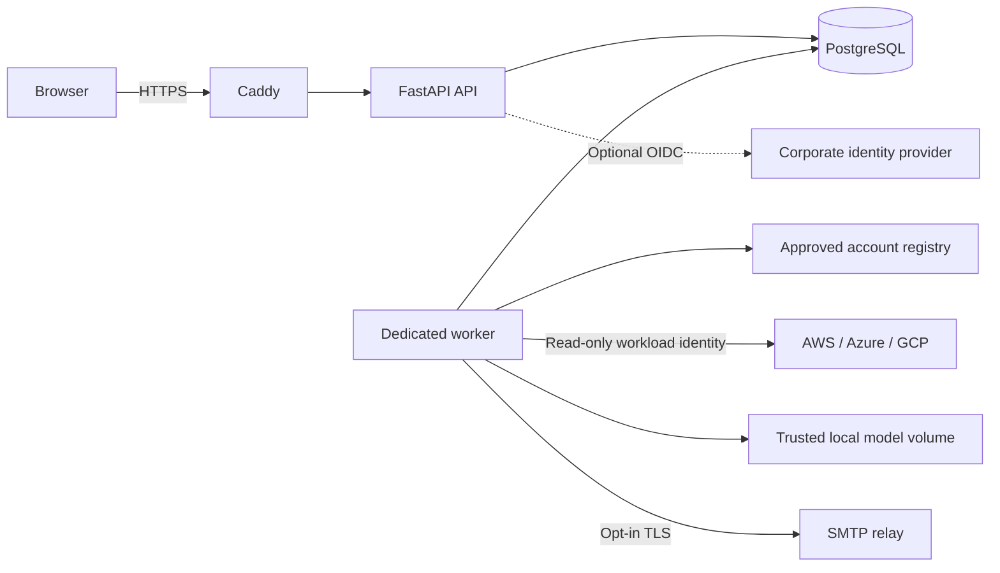

# Architecture

CloudSentinel is a self-hosted, single-organization application. Demo and
production share detection code while using separate startup policies and state.

## Code boundaries

`application.py` composes dependencies and lifecycle; `main.py` exposes the ASGI
entry point. HTTP routes translate requests into service calls. The shared
permissions policy drives both middleware checks and generated API role metadata.
Response contracts exclude internal session hashes and provider credentials.
`core` contains deployment settings without importing HTTP concerns.

`domain` owns validated inventories, approved account metadata, deterministic
rules, and activity aggregation. `services` orchestrates authentication,
collections, model evaluation, monitoring, alerts, and retention. Repositories
persist immutable evidence and separate mutable dispositions. Infrastructure
provides database connections, versioned SQL migrations, cloud SDK/REST adapters,
credential factories, archives, and SMTP delivery.

The frontend groups screens by feature. Shared API types and transport are
separate from reusable UI components. The application shell owns navigation and
selected snapshot scope. Account snapshot pointers prevent the newest scan of
one account from becoming the apparent state of every account.

## Collection transaction

1. An analyst submits an approved connection/region with an Idempotency-Key.
2. The API validates scope and durably queues the request, returning HTTP 202.
3. The singleton worker claims it and rechecks approval before requesting credentials.
4. Collectors normalize bounded read-only responses, retaining coverage gaps.
5. Rules and optional reviewed ML run. Snapshot, account pointer, alerts, and scan
   audit commit together. Failure preserves the previous valid pointer.
6. The job records success/failure; users inspect its result without holding an
   HTTP request open for cloud collection.

Short claim/admin transactions serialize using SQLite immediate transactions or
PostgreSQL transaction advisory locks. A separate database session advisory lock
allows one production worker. A persisted owner token fences obsolete workers
from publishing snapshots or finishing runs after ownership changes. A worker
watchdog exits a stuck process so container restart can recover interrupted jobs.
Execution is at least once: a crash after snapshot commit can leave an extra
historical snapshot on retry. Alert fingerprints suppress repeat observations.

## Storage and scaling contract

Production requires PostgreSQL; demo uses private SQLite/WAL. SQL parameters
remain bound and migrations are backend-specific, ordered, and transactional.
A connection pool bounds PostgreSQL connections. History reads indexed summary
metadata instead of loading full evidence for each row. Jobs and alerts expose
bounded pagination; run/audit views show recent records while retaining history.

The supplied deployment runs **one API process and one worker replica**. It is
not a distributed scheduler or high-availability topology. Collection bounds are
1,000 resources, 10,000 events, and 30 listing pages. For larger estates, approve
smaller supported scopes or extend collectors and validate capacity first.

Model files are trusted operator-controlled joblib artifacts, never uploads.
The worker can write its model volume; the API mounts it read-only. Production
ML is disabled unless explicitly enabled with a reviewed non-synthetic artifact.

See [security](security.md), [operations](operations.md), and
[deployment](deployment.md) for trust boundaries and operating procedures.
