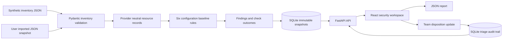

# Phase 1 architecture

CloudSentinel is a local React dashboard backed by FastAPI and SQLite. A common
typed inventory schema lets the same checks evaluate resources across the three
providers. There are no outbound cloud API calls.

## Data contracts

`backend/app/models.py` defines the provider, resource types, configuration,
inventory, and triage status. Inventory contains 1–1,000 resources with unique
IDs within each provider. Imports reject unknown keys, invalid CIDRs or ports,
string booleans, malformed JSON, and unsupported schema versions.

Configuration evidence represents normalized snapshot assertions. It is not a
full cloud policy evaluation. A later collector must evaluate provider settings
and map them into this contract accurately. The importer never accepts credentials.

## Rule evaluation

`backend/app/rules.py` evaluates only rules applicable to a resource's type.
An outcome is pass, fail, or unknown. Required missing fields yield unknown.
The exception is the MFA check for an explicitly non-admin identity: it passes
because the privileged-human rule is not violated.

Failed checks generate findings with a stable SHA-256-derived identifier from
provider, resource ID, and rule ID. Findings contain severity, category, affected
resource, evidence, and remediation. The severity is a project-defined baseline,
not CVSS or a vendor compliance score.

Posture is `round(passed / (passed + failed) × 100)`. It is null if all checks are
unknown. Coverage, passed/failed counts, and unknown counts remain visible.

## Persistence

`backend/app/store.py` saves the resource configurations, checks, findings, and
summary together in a SQLite transaction. The default database is under
`.runtime/` and excluded from Git. WAL mode and a connection timeout support
concurrent local reads and short writes.

Scan snapshots are immutable. Separate tables store finding dispositions and
triage events. Current dispositions are joined into historical responses, so
historical evidence and scores remain fixed while team review status remains
current. Repeated scans retain dispositions for identical finding fingerprints.

History lists the latest 100 records. The database retains older snapshots; there
is no retention cleanup, pagination beyond this list, or scan deletion in Phase 1.

## API and frontend

API routes are under `/api/v1`. Swagger documentation is available at `/docs`.
Imports read and bound the request stream before validation. Blocking scan and
SQLite work runs outside the async request loop. Mutations reject unrelated
browser origins, and the API accepts local hosts only. SQL uses placeholders.

Vite proxies local development requests to port 8000. For local use,
`scripts/demo.sh` builds the frontend first, then FastAPI serves `frontend/dist/`
and the API on the same local origin. Navigation stays within the React app,
so there is no client-side URL routing or fallback dependency.

The interface provides focus states, labeled controls, empty/error messages,
reduced-motion support, and a responsive menu. Inspection dialogs close with
Escape, trap keyboard focus, and restore focus to their trigger.

## Operational limits

The service is intended for one local project team on loopback. There is no
authentication, authorization, deployment hardening, distributed job queue,
live monitoring, training pipeline, or ML inference. Imports and scans are
synchronous and bounded. The input is a simplified configuration assertion,
not a provider-native API response. These boundaries are deliberate Phase 1 scope.
